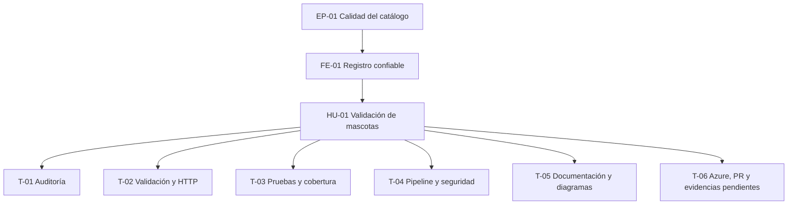
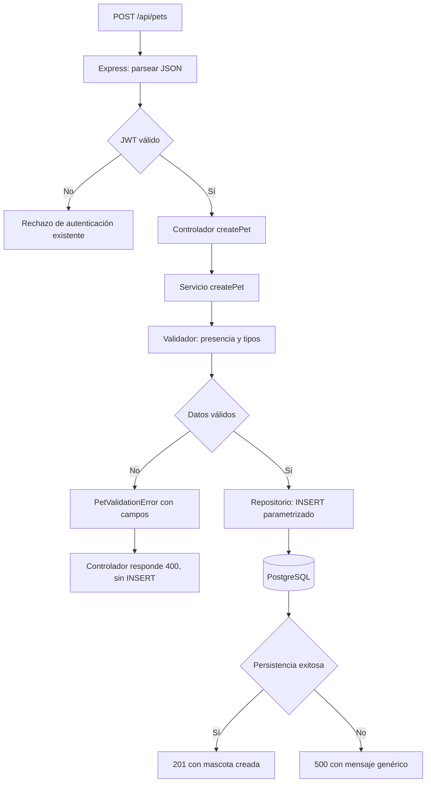

# Diagramas — Guía 4

## Jerarquía del trabajo

## Flujo de registro

JSON malformado lo rechaza Express antes del controlador; su parser no se modifica.
La validación de la HU no consulta PostgreSQL ni Auth0.

## Flujos independientes de ramas

```mermaid
flowchart TB
  subgraph EXISTENTE["Promoción existente - sin modificaciones"]
    D["development"] -->|"push dispara GitHub Actions"| J1["Job staging: merge ff-only"]
    J1 --> ST["staging"]
    ST -->|"segundo job depende del primero"| J2["Environment production: aprobación"]
    J2 -->|"merge ff-only"| P["production"]
  end
  subgraph ACADEMICO["Propuesta académica - PR manuales pendientes"]
    F["feature/hu-01-validacion-mascotas"] --> PR1["PR 1: cuatro validaciones obligatorias"]
    PR1 -->|"solo con checks y revisión aprobados"| DEV["develop"]
    DEV --> PR2["PR 2: cuatro validaciones obligatorias"]
    PR2 -->|"solo con checks y revisión aprobados"| INT["integration"]
    INT --> PR3["PR 3: cuatro validaciones obligatorias"]
    PR3 -->|"solo con checks y revisión aprobados"| MAIN["main"]
    G["SAST + OWASP Dependency-Check + cobertura + secretos"] -.-> PR1
    G -.-> PR2
    G -.-> PR3
    BLOCK["Cualquier fallo bloquea integración mediante checks requeridos"] -.-> G
  end
```

No hay conexión automática entre ambos flujos. Los gates del diagrama académico
describen la configuración por realizar en GitHub/Azure; el YAML por sí solo no
activa la protección. `main` existe desde el inicio; develop e integration deben
crearse manualmente desde la base auditada, sin tocar development.
