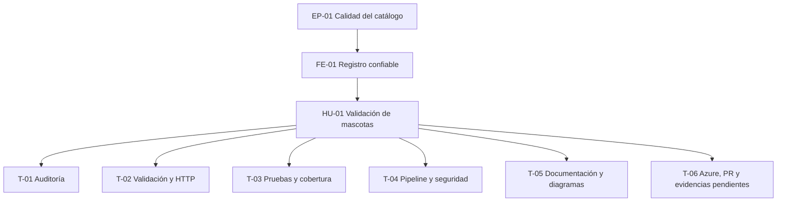
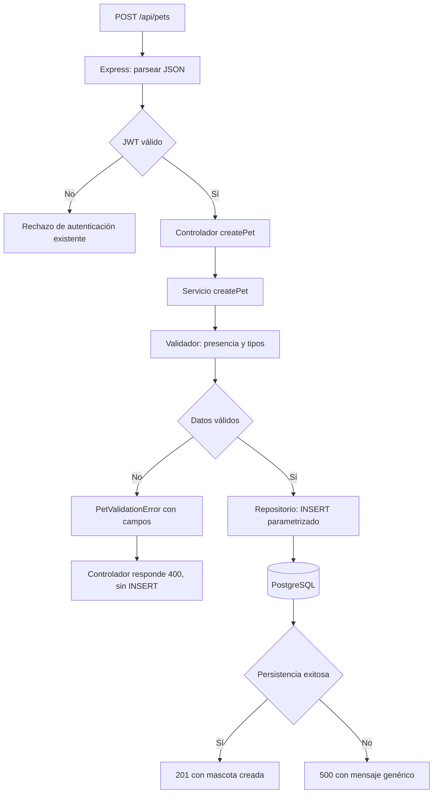
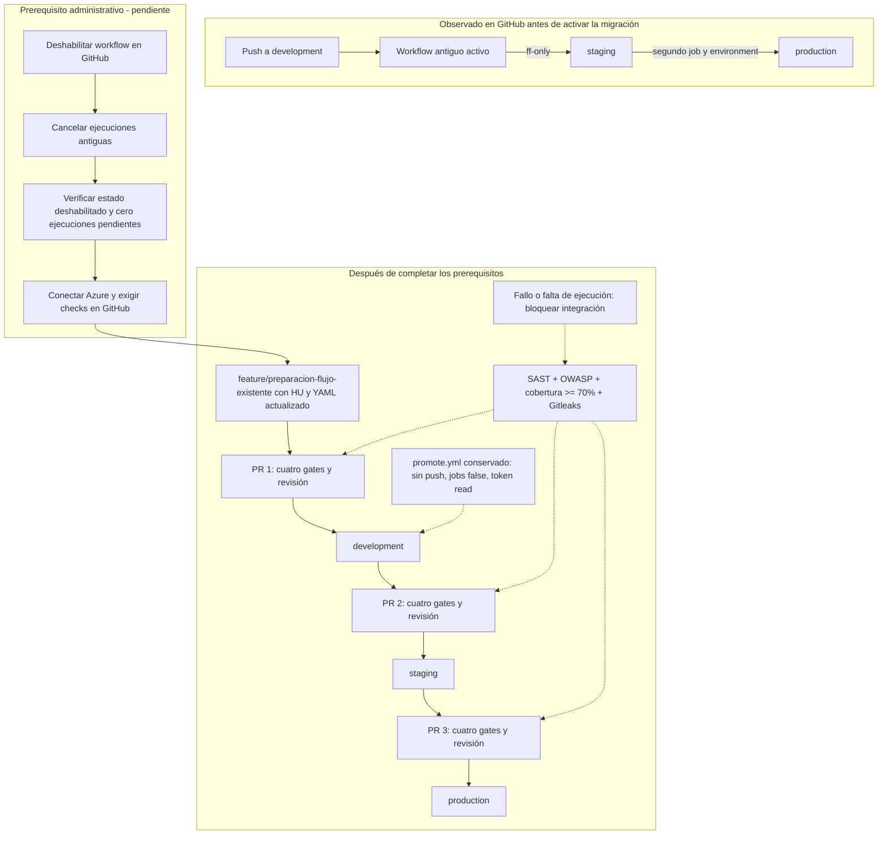

# Diagramas — Guía 4

## Jerarquía del trabajo

## Flujo de registro

JSON malformado lo rechaza Express antes del controlador; su parser no se modifica.
La validación de la HU no consulta PostgreSQL ni Auth0.

## Migración controlada y tres PR

El gráfico ANTES es evidencia del estado observado, no una ruta permitida durante
la entrega. No existe una promoción automática en el flujo propuesto. El workflow
continúa activo en GitHub hasta que un administrador complete la suspensión.
La rama original de HU conserva su YAML anterior: usar la rama de preparación
como origen de PR 1 o actualizar explícitamente la original antes de usarla.
Ver `07-migracion-flujo-existente.md` para activación, rollback y verificaciones.
