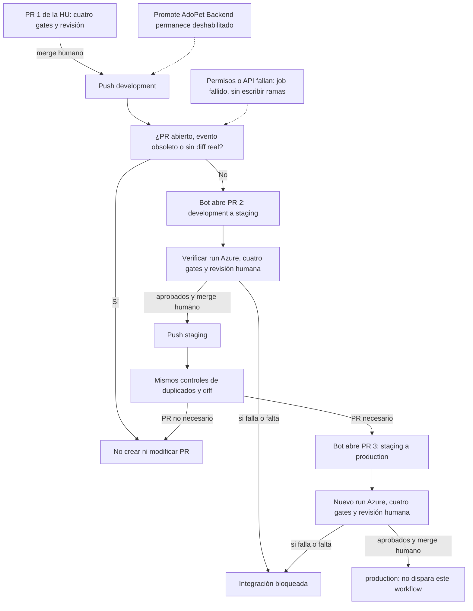

# Apertura automática de PR de promoción, sin integración automática

Preparado en `feature/preparacion-flujo-existente`. No se creó ningún PR durante
la implementación. No se cambian `azure-pipelines.yml`, sus cuatro gates ni
`.github/workflows/promote.yml`. Al auditar GitHub, el workflow antiguo ID 368470090
está **disabled_manually**; no se ha habilitado ni cambiado ese estado.
Este dato actualiza el snapshot histórico active de los documentos 07/08.

## Comportamiento

| Push recibido | Acción propuesta |
| --- | --- |
| development | Abrir PR development → staging si hace falta |
| staging | Abrir PR staging → production si hace falta |
| production, main, feature/*, tags o eliminación de rama | No actuar |

`.github/workflows/auto-promotion-pr.yml` llama a `scripts/auto-promotion-pr.js`.
Permisos únicos: `contents: read` y `pull-requests: write`, mediante GITHUB_TOKEN.
Actions fijadas por SHA; checkout sin persistir credenciales; sin dependencias npm
adicionales. La única operación de escritura API es `pulls.create`.
No hay merge, aprobación, auto-merge, actualización de refs ni push a ninguna rama.

1. Verifica evento/rama y busca un PR abierto con origen y destino exactos del mismo
   repositorio, incluidos drafts. Si existe, no lo modifica ni duplica.
2. Lee commits actuales. Un run de push obsoleto no crea PR.
3. Compara árboles: si el contenido final es idéntico, no crea PR aunque los commits
   sean distintos. Además exige commits propios de origen y archivos en el diff del PR.
4. Abre un PR listo para revisión, con checklist de Azure; no afirma que los checks pasaron.
5. Si GitHub responde 422, vuelve a buscar el PR: solo trata como éxito el duplicado
   concurrente confirmado. Otros 422, problemas de permisos o API fallan el job.

Concurrencia por rama con `cancel-in-progress: false` serializa ejecuciones del
workflow. GitHub puede sustituir un run pendiente por otro más reciente; se compara
el SHA para no actuar sobre eventos antiguos. La comprobación y creación no son una
transacción: un cambio externo de ramas puede producir rechazo; revisar y reintentar,
sin forzar ni fusionar. Un PR cerrado no se reabre; un push posterior con diferencias
puede proponer uno nuevo. No cierra PR existentes cuyo diff haya quedado vacío.

Errores 401/403 indican revisar token, políticas de creación de PR y límites API;
404 requiere revisar acceso y ramas; 422 requiere revisar comparación/estado;
429/errores de servicio requieren reintento revisado. No se imprimen excepciones
crudas, cuerpos HTTP, cabeceras ni secretos. No se eleva a PAT/App token como fallback.

## Semántica de eventos y GITHUB_TOKEN

Un merge humano genera un push a la rama destino; cuando el workflow esté instalado
en development/staging, ese push puede abrir el siguiente PR. Un push que solo cambia
documentación también se evalúa. No hay filtro de paths. Mensajes de exclusión CI
pueden omitir GitHub Actions; no usarlos para esta secuencia académica.
[Eventos omitidos por mensajes de commit](https://docs.github.com/en/actions/how-tos/manage-workflow-runs/skip-workflow-runs).

La documentación GitHub consultada el 16/11/2026 indica que los eventos generados
con GITHUB_TOKEN generalmente no encadenan Actions; actualmente exceptúa dispatches
y ciertos eventos PR (opened/synchronize/reopened), que pueden requerir aprobación
humana para ejecutar **workflows de GitHub Actions**. Un push realizado mediante
GITHUB_TOKEN no debe asumirse como disparador del siguiente workflow.
[Semántica oficial actual](https://docs.github.com/en/actions/how-tos/write-workflows/choose-when-workflows-run/trigger-a-workflow).

El bot solo abre PR: las integraciones posteriores son humanas y con checks requeridos.
La regla anterior de Actions no demuestra por sí sola si Azure recibe/ejecuta el PR.
Azure Pipelines es una integración externa: debe comprobarse cada evento y su run real.
No se ofrece una garantía de ejecución Azure basada únicamente en usar GITHUB_TOKEN.

## Cómo verificar Azure para cada PR del bot

1. Confirmar App Azure Pipelines instalada/autorizada, pipeline correcto y ruta
   `/azure-pipelines.yml`. Sus filtros deben incluir development/staging/production.
2. En el PR del bot, abrir Checks y seguir el enlace del check Azure. Confirmar en el
   run Build.Reason=PullRequest, PR ID, destino, SHA validado y referencia de merge.
   Revisar el YAML combinado, no solo el de la rama predeterminada.
3. Exigir Tests, SAST, Dependencies y Secrets realmente ejecutados y aprobados;
   cobertura >= 70 % por archivo HU, CVSS >= 7 bloqueante y los reportes propios.
   Un run de Open promotion PR exitoso no sustituye estos checks.
4. Si no aparece run, revisar autorización/App, entrega del evento, filtros,
   conflictos, YAML efectivo y ajustes de validación de autores externos/bots.
   Mantener el merge bloqueado. No editar gates ni cambiar token para eludir políticas.
5. Si Azure exige intervención, un propietario/colaborador autorizado puede solicitar
   la validación en el PR con `/AzurePipelines run AdoPet-Guia4`, usando el nombre real
   configurado y los comment triggers correspondientes. El bot no publica ese comentario.
   Comprobar después el run del PR y los cuatro jobs; una ejecución manual de rama
   sin contexto PR no basta.

[Azure: PR, YAML combinado y comment triggers](https://learn.microsoft.com/en-us/azure/devops/pipelines/repos/github?view=azure-devops).
Si no se logra validar el PR del bot con esta integración, detener la promoción y
documentar el bloqueo; no integrar por tener únicamente el PR creado.

## Plan de activación manual

1. Conservar disabled_manually del workflow antiguo y comprobar cero runs antiguos
   pendientes, según `07-migracion-flujo-existente.md`. Son workflows distintos:
   no rehabilitar Promote AdoPet Backend para habilitar Open promotion PR.
2. Revisar esta feature completa. Configurar previamente en GitHub revisión y los
   cuatro gates Azure requeridos para los tres destinos, sin bypass. Completar NVD.
3. Revisar Settings → Actions → General → Workflow permissions y permitir que
   Actions cree PR si la política de la organización lo permite. La opción de GitHub
   también menciona aprobar PR: el código no usa esa capacidad ni solicita reviews.
   No dar contents:write ni permisos adicionales. Si la política lo impide, mantener
   el fallo visible y resolverlo administrativamente.
4. Crear manualmente PR 1 feature/preparacion-flujo-existente → development y comprobar
   sus cuatro gates y revisión. No se ha creado en esta sesión. Al integrarlo por una
   persona autorizada, el push instala/ejecuta el nuevo workflow y propone PR 2.
5. Verificar PR 2 development → staging: autor bot, ramas exactas, diff real, único PR
   abierto, run Azure propio y revisión humana. Integrarlo solo con checks aprobados.
6. El push humano a staging debe proponer PR 3 staging → production. Repetir verificación.
   El merge a production no abre otro PR, pues esa rama no dispara este workflow.
7. Si falla la apertura por permisos o un error temporal, corregir la causa y reejecutar
   el run del push vigente. Si el run es obsoleto o se omitió por mensaje CI, gestionar
   un PR manual revisado; no generar pushes artificiales a ramas destino.

El workflow solo estará operativo cuando el archivo y su helper lleguen a las ramas
del push. Publicarlo en esta feature no lo activa para development o staging.

## Evidencias y rollback

- Capturar estado disabled_manually del antiguo y diff/SHAs de ambos archivos nuevos.
- Para cada salto, registrar push SHA → run Open promotion PR → PR ID → run Azure
  → cuatro reportes → revisión → merge humano, con SHAs y fechas.
- Reejecutar el mismo push vigente para evidenciar que no duplica PR abiertos.
- Documentar no-op sin diferencias y fallo 403 mediante pruebas locales; no alterar
  ramas compartidas ni permisos reales para fabricar evidencia.
- Ante incidente, deshabilitar **solo Open promotion PR** en GitHub y cancelar sus
  runs; el antiguo sigue deshabilitado. Los PR abiertos se revisan/cierran manualmente.
  Esto no modifica ramas ni desactiva Azure. Corregir/revertir solo nuevo workflow y
  helper por feature/PR, conservando las cuatro validaciones y sin habilitar el antiguo.

## Diagrama Mermaid

Validación local de esta preparación: actionlint 1.7.12 sin diagnósticos para el
workflow nuevo; 136 pruebas aprobadas (24 nuevas del bot y 112 existentes); cobertura
HU conservada en 100 %. Los tests usan API simulada y no crean PR. Semgrep ejecutó
68 reglas sobre el helper sin hallazgos. Gitleaks revisó los diffs antes de commit.
El diagrama siguiente se renderizó con Mermaid CLI 11.12.0. No se acredita una
ejecución del workflow en GitHub ni de Azure para un PR del bot: quedan pendientes
de la activación y sus evidencias. El análisis OWASP requiere NVD_API_KEY y no se
reejecutó durante este cambio, que no modifica dependencias ni sus controles.

